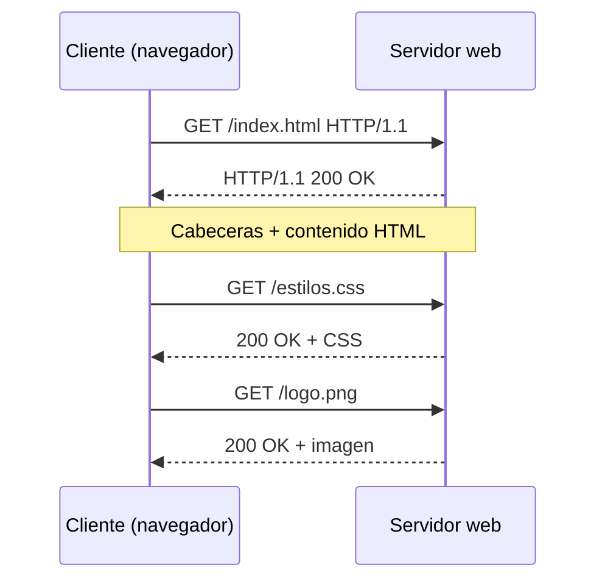
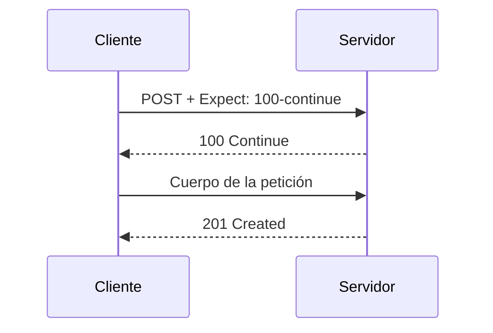
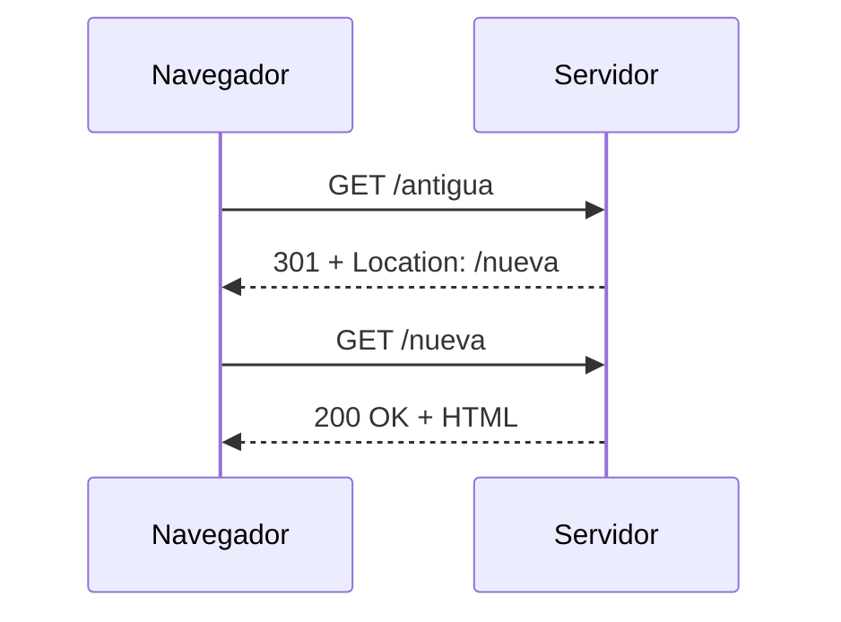

# HTTP y HTTPS

:::pageinfo
**HTTP (HyperText Transfer Protocol)** es el protocolo fundamental de comunicación de la Web.

Permite que un cliente, normalmente un navegador, solicite recursos a un servidor y reciba las correspondientes respuestas.

Estudiaremos HTTP, HTTPS, los métodos de petición, los códigos de estado, las cabeceras y su utilización en arquitecturas REST.
:::

## ¿Qué es HTTP?

:::definicion
**HTTP (HyperText Transfer Protocol)** es un protocolo de la **capa de aplicación** que establece las reglas para intercambiar mensajes entre clientes y servidores web.

Utiliza un modelo de comunicación basado en **peticiones y respuestas** (*request-response*).
:::

HTTP pertenece a la capa de aplicación tanto en el modelo OSI como en el modelo TCP/IP.

Sus principales características son:

- **Cliente-servidor:** el cliente inicia las peticiones y el servidor responde.
- **Sin estado (*stateless*):** cada petición es independiente de las anteriores.
- **Extensible:** admite cabeceras y funcionalidades adicionales.
- **Independiente del contenido:** permite transmitir HTML, JSON, imágenes, archivos, etc.

:::recuerda
HTTP es un protocolo **sin estado**.

Esto significa que el protocolo no recuerda automáticamente las peticiones anteriores.

Para mantener información entre peticiones, como una sesión de usuario, se utilizan mecanismos adicionales: cookies, sesiones o tokens.
:::

## HTTP frente a HTTPS

:::definicion
**HTTPS (HyperText Transfer Protocol Secure)** es HTTP protegido mediante **TLS (Transport Layer Security)**.

TLS proporciona cifrado, integridad y autenticación del servidor mediante certificados digitales.
:::

| Característica | HTTP | HTTPS |
|---|---|---|
| Seguridad | Sin cifrado | Cifrado mediante TLS |
| Puerto habitual | 80 | 443 |
| Esquema de URL | `http://` | `https://` |
| Certificado digital | No requiere | Normalmente certificado X.509 |
| Protección de datos | No | Sí, durante el transporte |

HTTPS ofrece tres propiedades fundamentales:

1. **Confidencialidad:** terceros no pueden leer fácilmente los datos transmitidos.
2. **Integridad:** permite detectar modificaciones en la comunicación.
3. **Autenticación:** permite comprobar la identidad del servidor.

:::recuerda
HTTPS no garantiza que una página sea legítima o que su contenido sea seguro.

Garantiza principalmente que la comunicación está protegida y que el certificado permite autenticar al servidor con el que nos conectamos.
:::

## Funcionamiento de HTTP: petición y respuesta

El intercambio de información sigue un proceso sencillo:

1. El usuario introduce una URL en el navegador.
2. El navegador obtiene la dirección IP del servidor mediante DNS, si es necesario.
3. Se establece la conexión de transporte.
4. Si se utiliza HTTPS, se negocia una conexión segura mediante TLS.
5. El cliente envía una petición HTTP.
6. El servidor procesa la petición.
7. El servidor devuelve una respuesta HTTP.
8. El navegador interpreta la respuesta y muestra el contenido.



:::recuerda
Una página web puede necesitar numerosas peticiones HTTP.

El navegador solicita inicialmente el documento HTML y posteriormente otros recursos: hojas de estilo, JavaScript, imágenes, fuentes, etc.

En HTTP/2 y HTTP/3 pueden intercambiarse varias peticiones y respuestas simultáneamente sobre una misma conexión.
:::

## Estructura de los mensajes HTTP

En HTTP/1.1, los mensajes tienen una representación textual formada por:

- Una **línea inicial**.
- Un conjunto de **cabeceras** (*headers*).
- Una línea en blanco.
- Un **cuerpo** (*body*) opcional.

### Petición HTTP

Ejemplo de petición:

```http
GET /productos/15 HTTP/1.1
Host: tienda.example.com
Accept: application/json
User-Agent: Mozilla/5.0

```

La primera línea contiene:

| Elemento | Significado |
|---|---|
| `GET` | Método HTTP |
| `/productos/15` | Recurso solicitado |
| `HTTP/1.1` | Versión del protocolo |

Las cabeceras aportan información adicional.

En este ejemplo:

- `Host`: identifica el servidor al que se dirige la petición.
- `Accept`: indica qué formatos de respuesta acepta el cliente.
- `User-Agent`: identifica el software cliente.

### Respuesta HTTP

```http
HTTP/1.1 200 OK
Content-Type: application/json
Content-Length: 34
Cache-Control: no-cache

{"id":15,"nombre":"Teclado USB"}
```

La primera línea contiene:

| Elemento | Significado |
|---|---|
| `HTTP/1.1` | Versión del protocolo |
| `200` | Código de estado |
| `OK` | Descripción del estado |

La respuesta incluye:

- **Cabeceras:** información sobre el contenido y su tratamiento.
- **Cuerpo:** datos devueltos por el servidor.

:::recuerda
El cuerpo no siempre existe.

Por ejemplo, una respuesta `204 No Content` no contiene cuerpo, y las respuestas a peticiones `HEAD` tampoco lo incluyen.
:::

## Métodos HTTP

Los métodos HTTP, también denominados **verbos HTTP**, indican qué operación desea realizar el cliente sobre un recurso.

| Método | Finalidad habitual | Ejemplo |
|---|---|---|
| `GET` | Obtener un recurso | Consultar un producto |
| `POST` | Enviar datos para su procesamiento | Crear un pedido |
| `PUT` | Crear o reemplazar el estado de un recurso | Sustituir un producto |
| `PATCH` | Modificar parcialmente un recurso | Cambiar su precio |
| `DELETE` | Eliminar un recurso | Borrar un producto |
| `HEAD` | Obtener únicamente las cabeceras | Consultar metadatos |
| `OPTIONS` | Consultar opciones de comunicación | Averiguar métodos admitidos |
| `TRACE` | Diagnóstico de peticiones | Comprobar el recorrido HTTP |
| `CONNECT` | Establecer un túnel | Comunicación mediante proxy |

Los métodos más utilizados en aplicaciones web son `GET`, `POST`, `PUT`, `PATCH` y `DELETE`.

### Ejemplos de métodos

**GET: consultar un producto**

```http
GET /api/productos/15 HTTP/1.1
Host: tienda.example.com
Accept: application/json
```

**POST: crear un producto**

```http
POST /api/productos HTTP/1.1
Host: tienda.example.com
Content-Type: application/json

{
  "nombre": "Ratón",
  "precio": 25
}
```

**PUT: reemplazar un producto**

```http
PUT /api/productos/15 HTTP/1.1
Host: tienda.example.com
Content-Type: application/json

{
  "nombre": "Ratón inalámbrico",
  "precio": 35
}
```

**PATCH: modificar únicamente el precio**

```http
PATCH /api/productos/15 HTTP/1.1
Host: tienda.example.com
Content-Type: application/json

{
  "precio": 30
}
```

**DELETE: eliminar un producto**

```http
DELETE /api/productos/15 HTTP/1.1
Host: tienda.example.com
```

### Métodos seguros e idempotentes

Los métodos HTTP tienen propiedades importantes.

:::definicion
Un método es **seguro** cuando su finalidad no es modificar el estado del servidor.

Un método es **idempotente** cuando realizar la misma petición varias veces tiene el mismo efecto previsto sobre el estado del servidor que realizarla una sola vez.
:::

| Método | Seguro | Idempotente |
|---|---|---|
| GET | Sí | Sí |
| HEAD | Sí | Sí |
| OPTIONS | Sí | Sí |
| POST | No | No |
| PUT | No | Sí |
| PATCH | No | No necesariamente |
| DELETE | No | Sí |

Por ejemplo:

- Ejecutar `GET /productos/15` varias veces no debería modificar el producto.
- Ejecutar `PUT /productos/15` varias veces con los mismos datos debería producir el mismo estado final.
- Ejecutar `DELETE /productos/15` repetidamente mantiene el recurso eliminado, aunque los códigos de respuesta puedan cambiar.
- Ejecutar `POST /pedidos` varias veces podría crear varios pedidos.

:::pregunta
¿Por qué es importante la idempotencia cuando una petición falla y el cliente necesita repetirla?
:::

## HTTP y las API REST

HTTP es un protocolo de comunicación. **REST**, en cambio, es un estilo arquitectónico para diseñar sistemas distribuidos.

:::definicion
**REST (Representational State Transfer)** es un estilo arquitectónico que propone trabajar con recursos identificados mediante URI, utilizando una interfaz uniforme y comunicaciones sin estado, entre otras restricciones.
:::

En una API REST, los recursos se representan mediante direcciones como:

```text
/api/productos
/api/productos/15
/api/clientes
/api/clientes/8/pedidos
```

Una práctica habitual consiste en utilizar los métodos HTTP de acuerdo con su significado.

| Operación | Método | Recurso |
|---|---|---|
| Listar productos | GET | `/api/productos` |
| Consultar producto | GET | `/api/productos/15` |
| Crear producto | POST | `/api/productos` |
| Reemplazar producto | PUT | `/api/productos/15` |
| Modificar producto | PATCH | `/api/productos/15` |
| Eliminar producto | DELETE | `/api/productos/15` |

De esta forma, **la URL identifica el recurso y el método HTTP expresa la operación**.

### REST frente a SOAP

Otra tecnología utilizada para desarrollar servicios web es **SOAP (Simple Object Access Protocol)**.

SOAP es un protocolo de mensajería basado en XML que puede utilizar distintos transportes, incluido HTTP.

| Característica | REST | SOAP |
|---|---|---|
| Naturaleza | Estilo arquitectónico | Protocolo de mensajería |
| Uso de HTTP | Aprovecha sus métodos y semántica | Puede utilizar HTTP como transporte |
| Formato | JSON, XML, HTML, etc. | XML |
| Contrato | Puede utilizar OpenAPI | Habitualmente WSDL |
| Complejidad | Generalmente menor | Generalmente mayor |
| Uso frecuente | API web y aplicaciones modernas | Integraciones empresariales |

En servicios SOAP sobre HTTP es frecuente enviar operaciones mediante `POST`, incorporando un mensaje XML en el cuerpo.

En REST, en cambio, se aprovechan directamente los métodos y códigos de estado HTTP.

:::recuerda
**REST no es un protocolo ni una especificación que obligue a utilizar JSON.**

Una API REST puede intercambiar distintas representaciones de recursos.

También existen otras alternativas para desarrollar API, como **GraphQL**, que permite al cliente indicar los datos que necesita, o **gRPC**, basado habitualmente en HTTP/2 y Protocol Buffers.
:::

## Códigos de estado HTTP

Cada respuesta HTTP incluye un **código de estado** que informa sobre el resultado de la petición.

Los códigos se agrupan en cinco categorías.

| Grupo | Significado |
|---|---|
| `1xx` | Respuestas informativas |
| `2xx` | Operación satisfactoria |
| `3xx` | Redirección |
| `4xx` | Error del cliente |
| `5xx` | Error del servidor |

### Respuestas informativas: 1xx

Indican que la comunicación continúa y que todavía no se ha producido la respuesta final.

| Código | Significado |
|---|---|
| `100 Continue` | El cliente puede continuar enviando el cuerpo |
| `101 Switching Protocols` | El servidor acepta cambiar de protocolo |
| `102 Processing` | El servidor sigue procesando la petición |
| `103 Early Hints` | Permite anticipar recursos que pueden necesitarse |

#### El código 100 Continue

El código `100 Continue` es especialmente interesante porque normalmente no aparece al navegar por una página web.

Se utiliza cuando el cliente desea enviar un cuerpo de petición, pero antes quiere comprobar si el servidor está dispuesto a recibirlo.

El cliente envía:

```http
POST /subir HTTP/1.1
Host: ejemplo.com
Content-Length: 1000000
Expect: 100-continue
```

El servidor puede responder:

```http
HTTP/1.1 100 Continue
```

Entonces el cliente continúa enviando el cuerpo.

Finalmente, el servidor devuelve una respuesta definitiva:

```http
HTTP/1.1 201 Created
```



:::recuerda
`100 Continue` es una **respuesta provisional**, no la respuesta definitiva.

El servidor también puede responder directamente con un error, por ejemplo `401 Unauthorized` o `413 Content Too Large`, sin aceptar previamente el cuerpo completo.
:::

### Respuestas satisfactorias: 2xx

| Código | Significado |
|---|---|
| `200 OK` | Petición realizada correctamente |
| `201 Created` | Recurso creado correctamente |
| `202 Accepted` | Petición aceptada para procesamiento posterior |
| `204 No Content` | Operación correcta, sin cuerpo de respuesta |
| `206 Partial Content` | Se devuelve una parte del recurso |

#### El código 201 Created

Se utiliza cuando una petición provoca la creación de un recurso.

Por ejemplo:

```http
POST /api/productos HTTP/1.1
Host: tienda.example.com
Content-Type: application/json

{"nombre":"Monitor","precio":150}
```

El servidor puede responder:

```http
HTTP/1.1 201 Created
Location: /api/productos/25
Content-Type: application/json

{"id":25,"nombre":"Monitor","precio":150}
```

La cabecera `Location` identifica el recurso creado.

:::recuerda
Una respuesta `201 Created` indica que el recurso se ha creado.

Es habitual que aparezca como respuesta a `POST`, aunque también puede producirse con otros métodos, como `PUT`.
:::

### Redirecciones: 3xx

Las respuestas `3xx` indican que el cliente debe realizar alguna acción adicional para completar la petición, frecuentemente acceder a otra URL.

| Código | Significado |
|---|---|
| `301 Moved Permanently` | Recurso trasladado permanentemente |
| `302 Found` | Redirección temporal |
| `303 See Other` | Consultar otro recurso mediante GET |
| `304 Not Modified` | El recurso almacenado en caché sigue siendo válido |
| `307 Temporary Redirect` | Redirección temporal conservando el método |
| `308 Permanent Redirect` | Redirección permanente conservando el método |

#### Ejemplo de redirección

El navegador solicita:

```http
GET /antigua HTTP/1.1
Host: ejemplo.com
```

El servidor responde:

```http
HTTP/1.1 301 Moved Permanently
Location: https://ejemplo.com/nueva
```

El navegador realiza automáticamente una nueva petición:

```http
GET /nueva HTTP/1.1
Host: ejemplo.com
```



:::recuerda
Una redirección implica normalmente **una nueva petición HTTP**.

Los códigos `307` y `308` garantizan que el método y el cuerpo se mantienen en la nueva petición.

Con `301` y `302`, los navegadores pueden transformar una petición `POST` en `GET` por compatibilidad histórica.
:::

### Errores del cliente: 4xx

| Código | Significado |
|---|---|
| `400 Bad Request` | Petición incorrecta |
| `401 Unauthorized` | Se requiere autenticación válida |
| `403 Forbidden` | Acceso prohibido |
| `404 Not Found` | Recurso no encontrado |
| `405 Method Not Allowed` | Método no permitido |
| `408 Request Timeout` | Tiempo de espera agotado |
| `409 Conflict` | Conflicto con el estado del recurso |
| `413 Content Too Large` | Cuerpo de petición demasiado grande |
| `422 Unprocessable Content` | Contenido válido sintácticamente, pero no procesable |
| `429 Too Many Requests` | Demasiadas peticiones |

:::pregunta
¿Cuál es la diferencia entre `401 Unauthorized` y `403 Forbidden`?

¿Y entre `400 Bad Request` y `404 Not Found`?
:::

### Errores del servidor: 5xx

| Código | Significado |
|---|---|
| `500 Internal Server Error` | Error interno del servidor |
| `501 Not Implemented` | Funcionalidad no implementada |
| `502 Bad Gateway` | Respuesta incorrecta de otro servidor |
| `503 Service Unavailable` | Servicio temporalmente no disponible |
| `504 Gateway Timeout` | Tiempo de espera agotado al consultar otro servidor |

En aplicaciones PHP, un error no controlado puede provocar una respuesta `500`.

En arquitecturas con proxy inverso, como Nginx delante de Apache, pueden aparecer errores `502` o `504` cuando falla la comunicación con el servidor de destino.

## Cabeceras HTTP

:::definicion
Las **cabeceras HTTP** (*headers*) son campos que acompañan a las peticiones y respuestas para proporcionar información adicional sobre la comunicación.
:::

Algunas cabeceras habituales son:

| Cabecera | Utilidad |
|---|---|
| `Host` | Identifica el servidor solicitado en HTTP/1.1 |
| `User-Agent` | Identifica el software cliente |
| `Accept` | Formatos aceptados por el cliente |
| `Accept-Language` | Idiomas preferidos |
| `Content-Type` | Tipo de contenido enviado |
| `Content-Length` | Tamaño del cuerpo en bytes |
| `Authorization` | Credenciales de autenticación |
| `Cookie` | Cookies enviadas al servidor |
| `Set-Cookie` | Cookies establecidas por el servidor |
| `Location` | URL asociada a una redirección o recurso creado |
| `Cache-Control` | Directivas de almacenamiento en caché |
| `Server` | Información opcional sobre el servidor |
| `Strict-Transport-Security` | Política para utilizar HTTPS en futuras conexiones |

### Ejemplo de cabeceras de respuesta

```http
HTTP/1.1 200 OK
Date: Mon, 02 Nov 2026 11:00:00 GMT
Content-Type: text/html; charset=UTF-8
Content-Length: 1250
Cache-Control: max-age=3600
Server: Apache
```

La cabecera:

```http
Content-Type: text/html; charset=UTF-8
```

indica que el contenido es HTML y utiliza codificación UTF-8.

La cabecera:

```http
Cache-Control: max-age=3600
```

permite considerar la respuesta reutilizable durante 3600 segundos, según las reglas de caché aplicables.

## Versiones de HTTP

HTTP ha evolucionado para mejorar el rendimiento y la eficiencia de las comunicaciones.

| Versión | Características |
|---|---|
| HTTP/1.0 | Modelo básico de peticiones y respuestas |
| HTTP/1.1 | Conexiones persistentes y mejoras en caché y transferencia |
| HTTP/2 | Formato binario y multiplexación |
| HTTP/3 | Utiliza QUIC sobre UDP |

### HTTP/1.1

HTTP/1.1 introdujo y consolidó funcionalidades importantes:

- Conexiones persistentes por defecto.
- Cabecera `Host` obligatoria.
- Transferencias fragmentadas (*chunked*).
- Mejoras en mecanismos de caché.

Su representación de mensajes es textual.

```http
GET / HTTP/1.1
Host: example.com
Connection: keep-alive
```

### HTTP/2

HTTP/2 conserva la semántica HTTP, pero cambia la forma de transmitir los mensajes.

Sus principales características son:

- Comunicación mediante tramas binarias.
- Multiplexación de varias peticiones en una conexión.
- Compresión de cabeceras mediante HPACK.
- Mayor eficiencia en la transferencia.

### HTTP/3

HTTP/3 utiliza **QUIC**, un protocolo de transporte basado en UDP.

Sus principales ventajas son:

- Establecimiento de conexiones más eficiente.
- Multiplexación sin el bloqueo entre flujos provocado por pérdidas en TCP.
- Integración de seguridad TLS 1.3 en QUIC.
- Mejor comportamiento ante determinados cambios de red.

:::recuerda
HTTP/1.1, HTTP/2 y HTTP/3 mantienen esencialmente la misma semántica de métodos, cabeceras y códigos de estado.

Lo que cambia principalmente es la forma de transportar y representar los mensajes.
:::

## Inspeccionar HTTP con curl

`curl` es una herramienta de línea de comandos que permite realizar peticiones HTTP y examinar las respuestas del servidor.

Es especialmente útil para desarrollar y depurar aplicaciones web.

### Obtener únicamente las cabeceras

```bash
curl -I https://example.com
```

La opción `-I` realiza una petición `HEAD`.

El servidor devuelve las cabeceras sin el cuerpo del recurso.

### Mostrar cabeceras y contenido

```bash
curl -i https://example.com
```

La opción `-i` muestra las cabeceras de respuesta junto con el contenido.

### Mostrar información detallada

```bash
curl -v https://example.com
```

La opción `-v` (*verbose*) permite observar:

- La conexión establecida.
- Información de TLS cuando se utiliza HTTPS.
- Las cabeceras enviadas por el cliente.
- Las cabeceras recibidas del servidor.

### Seguir redirecciones

```bash
curl -I https://github.com
```

Para seguir automáticamente las redirecciones:

```bash
curl -IL https://github.com
```

La opción `-L` indica que `curl` debe seguir las redirecciones.

### Seleccionar la versión HTTP

Solicitar HTTP/1.1:

```bash
curl --http1.1 -I https://example.com
```

Solicitar HTTP/2:

```bash
curl --http2 -I https://example.com
```

Solicitar HTTP/3, si la instalación de curl lo admite:

```bash
curl --http3-only -I https://example.com
```

Para comprobar las versiones admitidas por nuestra instalación:

```bash
curl -V
```

### Enviar métodos y cabeceras personalizados

Realizar una petición GET:

```bash
curl https://jsonplaceholder.typicode.com/posts/1
```

Enviar una cabecera:

```bash
curl -H "Accept: application/json" \
     https://jsonplaceholder.typicode.com/posts/1
```

Realizar una petición POST:

```bash
curl -i -X POST \
     -H "Content-Type: application/json" \
     -d '{"title":"Ejemplo","body":"Contenido","userId":1}' \
     https://jsonplaceholder.typicode.com/posts
```

El servicio de pruebas devuelve una respuesta que simula la creación del recurso.

### Observar una respuesta 100 Continue

Podemos solicitar que `curl` envíe la cabecera `Expect`:

```bash
curl --http1.1 -v \
     -H "Expect: 100-continue" \
     -H "Content-Type: application/json" \
     --data-binary '{"mensaje":"Hola"}' \
     https://httpbin.org/post
```

Si el servidor o un intermediario responde con `100 Continue`, podremos observarlo en la salida detallada.

:::recuerda
Enviar `Expect: 100-continue` no garantiza recibir `100 Continue`.

El servidor puede responder directamente con un estado final, y `curl` también puede continuar el envío después de esperar cierto tiempo.
:::

## HTTP desde PHP

PHP permite consultar y modificar diferentes aspectos de la comunicación HTTP.

### Consultar el método de petición

```php
<?php
$metodo = $_SERVER['REQUEST_METHOD'];

echo "Método utilizado: $metodo";
```

### Establecer un código de estado

```php
<?php
http_response_code(201);

header('Content-Type: application/json');

echo json_encode([
    'mensaje' => 'Producto creado correctamente',
    'id' => 25
]);
```

### Realizar una redirección

```php
<?php
header('Location: /nueva-pagina.php', true, 302);
exit;
```

La función `header()` permite establecer cabeceras HTTP antes de enviar el cuerpo de la respuesta.

:::recuerda
En PHP, las cabeceras deben establecerse antes de enviar contenido al cliente, salvo que exista un mecanismo de almacenamiento en búfer que lo permita.

Por eso, las redirecciones suelen realizarse antes de generar HTML.
:::

## Actividades

:::actividad
**Actividad 1. Inspeccionar una respuesta HTTP**

Ejecuta:

```bash
curl -I https://example.com
```

Identifica:

1. El código de estado.
2. La versión HTTP utilizada.
3. El tipo de contenido, si aparece.
4. Las cabeceras relacionadas con caché.
5. La presencia de cabeceras de seguridad.
   :::

:::actividad
**Actividad 2. Analizar una redirección**

Ejecuta:

```bash
curl -I http://github.com
curl -IL http://github.com
```

Compara los resultados e identifica:

- Los códigos de estado obtenidos.
- Las cabeceras `Location`.
- La URL final.
- El número de respuestas recibidas.
  :::

:::actividad
**Actividad 3. Trabajar con una API**

Utiliza `curl` para consultar y crear recursos en:

`https://jsonplaceholder.typicode.com`

Realiza las siguientes operaciones:

1. Obtener todos los posts.
2. Obtener el post número 5.
3. Crear un post utilizando POST.
4. Consultar el código de estado de cada respuesta.
5. Identificar el formato de los datos intercambiados.
   :::

:::pregunta
**Cuestiones de repaso**

1. ¿Por qué HTTP pertenece a la capa de aplicación?
2. ¿Qué diferencia existe entre HTTP y HTTPS?
3. ¿Qué significa que HTTP sea un protocolo sin estado?
4. ¿Qué diferencia existe entre GET y POST?
5. ¿Qué diferencia existe entre PUT y PATCH?
6. ¿Qué significa que un método sea idempotente?
7. ¿Qué representa el código `100 Continue`?
8. ¿Cuándo utilizaríamos `201 Created`?
9. ¿Qué diferencia existe entre una redirección `301` y una `307`?
10. ¿Qué diferencias existen entre REST y SOAP?
11. ¿Qué ventajas aporta HTTP/2 frente a HTTP/1.1?
12. ¿Qué protocolo de transporte utiliza HTTP/3?
    :::

## Referencias

- [HTTP Semantics — RFC 9110](https://www.rfc-editor.org/rfc/rfc9110)
- [HTTP/1.1 — RFC 9112](https://www.rfc-editor.org/rfc/rfc9112)
- [HTTP/2 — RFC 9113](https://www.rfc-editor.org/rfc/rfc9113)
- [HTTP/3 — RFC 9114](https://www.rfc-editor.org/rfc/rfc9114)
- [HTTP — MDN Web Docs](https://developer.mozilla.org/es/docs/Web/HTTP)
- [Documentación de curl](https://curl.se/docs/)