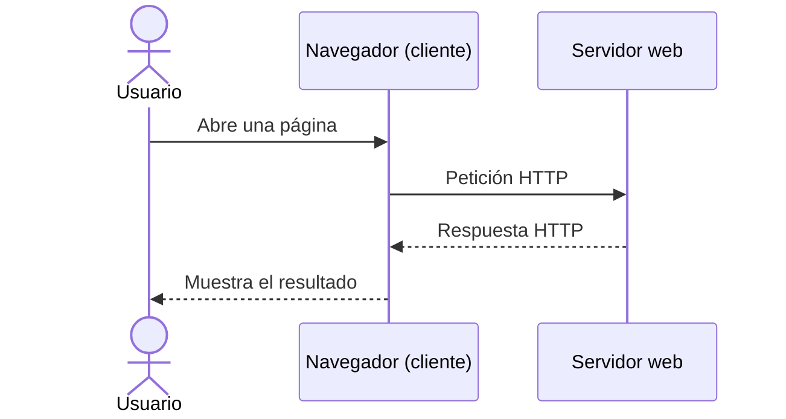
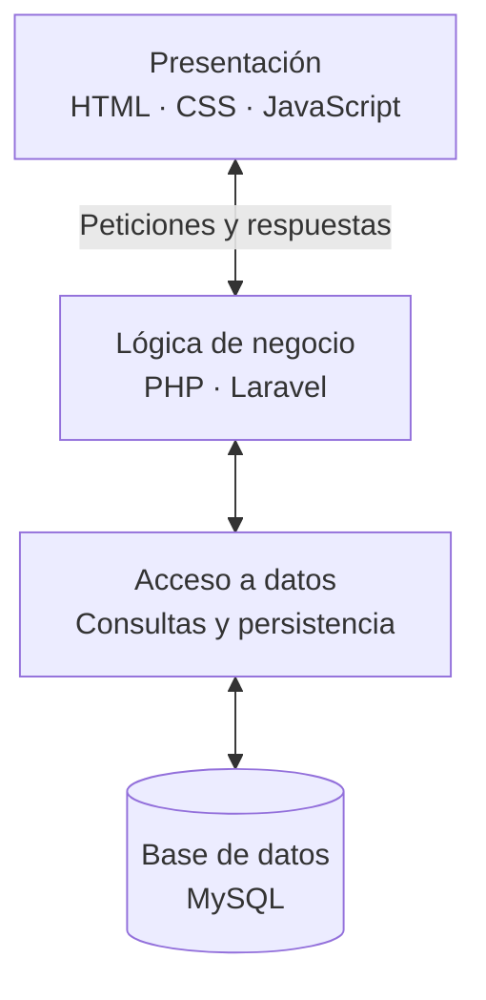

# Conceptos y arquitectura web

Antes de empezar a desarrollar aplicaciones web, necesitamos comprender **qué vamos a construir, cómo se organiza y qué herramientas utilizaremos**.

## 1. ¿Qué es la arquitectura web?

Nuestro objetivo es **construir aplicaciones que funcionen en un entorno web**. Podemos compararlo con la construcción de un edificio: antes de levantarlo, necesitamos decidir cómo será, qué materiales emplearemos y quién realizará cada trabajo.

En el desarrollo web también necesitamos:

1. **Planificar y diseñar:** analizar las necesidades y definir cómo funcionará la aplicación.
2. **Elegir herramientas y tecnologías:** lenguajes, servidores, bases de datos y frameworks.
3. **Organizar el trabajo:** distribuir las responsabilidades entre los distintos profesionales.

::: definicion ¿Qué es la arquitectura web?
La **arquitectura web** describe cómo se estructura una aplicación, cuáles son sus componentes, qué responsabilidades tiene cada uno y cómo se comunican entre sí.
:::

> **Idea fundamental:** la arquitectura es la organización de la solución; las tecnologías son las herramientas concretas que elegimos para construirla.

## 2. El modelo cliente-servidor

Una aplicación web suele basarse en el modelo **cliente-servidor**:

- El **cliente**, normalmente un navegador, solicita un recurso o realiza una operación.
- El **servidor** recibe la petición, la atiende y devuelve una respuesta.
- Ambos se comunican habitualmente mediante **HTTP o HTTPS**.

Una respuesta puede contener HTML, CSS, JavaScript, imágenes, datos JSON u otros recursos. No todas las peticiones generan una página HTML completa.

## 3. Frontend y backend

En una aplicación web distinguimos dos grandes ámbitos de desarrollo.

### Frontend: la parte del cliente

Es la parte con la que interactúa el usuario. Habitualmente se ejecuta en el navegador y se construye con:

- **HTML:** estructura del contenido.
- **CSS:** presentación y estilos.
- **JavaScript:** comportamiento e interactividad.

Por ejemplo, un formulario que permite introducir datos y muestra mensajes de validación.

### Backend: la parte del servidor

Es la lógica que se ejecuta en el servidor. Se encarga, entre otras tareas, de **procesar peticiones, aplicar reglas de negocio, comprobar permisos, consultar datos y generar respuestas**.

Podemos desarrollarlo con PHP, JavaScript (Node.js), Python, Java y otras tecnologías.

Por ejemplo, comprobar las credenciales de un usuario y guardar información en una base de datos.

| Aspecto | Frontend | Backend |
|---|---|---|
| Dónde se ejecuta habitualmente | Navegador del usuario | Servidor |
| Tecnologías habituales | HTML, CSS, JavaScript, Vue, React | PHP, Node.js, Python, Java, Laravel |
| Responsabilidad principal | Interfaz e interacción | Lógica de negocio y acceso a datos |
| Ejemplo | Formulario de registro | Validar y guardar el registro |
| Visibilidad | El usuario interactúa directamente con él | Su código no se entrega al navegador para ejecutarse |

::: recuerda
El **frontend** presenta información y permite interactuar; el **backend** procesa las operaciones y proporciona los datos o resultados necesarios.
:::

## 4. Una metáfora: el restaurante web

Imagina una aplicación web como un restaurante:

| En el restaurante | En la aplicación web |
|---|---|
| **Mesa, carta y utensilios** | Frontend: lo que el usuario ve y utiliza |
| **Cocina y cocineros** | Backend: procesa los pedidos y prepara los resultados |
| **Despensa** | Base de datos: almacena la información necesaria |
| **Camarero** | Comunicación entre cliente y servidor mediante peticiones y respuestas |

El comensal elige un plato, el camarero lleva el pedido a la cocina, los cocineros consultan los ingredientes y preparan el plato, y el camarero devuelve el resultado a la mesa.

Del mismo modo, el usuario realiza una acción en el navegador, el servidor la procesa y devuelve una respuesta. El navegador puede permitir después nuevas interacciones sin consultar necesariamente al servidor, igual que el comensal puede añadir sal a su plato.

> La metáfora ayuda a comprender las responsabilidades, aunque no representa literalmente el funcionamiento de todos los componentes.

## 5. Componentes principales de una aplicación web

### Cliente web

Generalmente es un **navegador**. Interpreta HTML, aplica CSS, ejecuta JavaScript y permite al usuario interactuar con la aplicación.

### Servidor web

Es el software que **recibe peticiones HTTP y envía respuestas**. Puede servir archivos estáticos o colaborar con una aplicación que genera contenido dinámico.

Ejemplos: **Apache** y **Nginx**.

### Entorno de ejecución en el servidor

Permite ejecutar el código del backend. Según la tecnología, se integra de diferentes formas con el servidor web o puede atender las peticiones HTTP directamente.

Ejemplos: **PHP**, **Node.js**, **Python** o una plataforma Java.

En este módulo trabajaremos principalmente con **PHP**.

### Sistema gestor de bases de datos

Permite almacenar, consultar y modificar información de forma organizada.

Ejemplos: **MySQL**, **PostgreSQL** y **MongoDB**.

La base de datos no tiene por qué estar instalada en la misma máquina que el servidor web.

### Lenguajes y frameworks

Los lenguajes permiten programar el comportamiento de la aplicación. Los **frameworks** proporcionan estructuras, convenciones y herramientas que facilitan su desarrollo.

Por ejemplo, **Laravel** es un framework de PHP y **Vue** es un framework de JavaScript orientado a interfaces de usuario.

## 6. Arquitectura de tres capas

Una forma habitual de organizar una aplicación es separar sus responsabilidades en **tres capas lógicas**:

1. **Presentación:** muestra la interfaz y recoge las acciones del usuario.
2. **Lógica de negocio:** aplica las reglas de la aplicación y coordina las operaciones.
3. **Acceso a datos:** gestiona el almacenamiento y la recuperación de información.

::: recuerda
**Tres capas no significa necesariamente tres servidores físicos.** Podemos ejecutar varios componentes en una misma máquina o distribuirlos entre distintos servidores.

Separar responsabilidades facilita el mantenimiento, las pruebas, la evolución de la aplicación y el trabajo en equipo.
:::

## 7. Arquitectura y tecnologías: ¿son lo mismo?

**No.** La arquitectura define cómo se organiza el sistema; las tecnologías son los productos, lenguajes y herramientas que empleamos para implementarlo.

Por ejemplo, una aplicación cliente-servidor con tres capas puede construirse con distintas combinaciones de tecnologías.

| Conjunto tecnológico | Tecnologías habituales | Características |
|---|---|---|
| **LAMP** | Linux, Apache, MySQL, PHP | Combinación clásica para aplicaciones web dinámicas |
| **WAMP** | Windows, Apache, MySQL, PHP | Variante del entorno anterior sobre Windows |
| **MEAN** | MongoDB, Express, Angular, Node.js | JavaScript/TypeScript en gran parte de la aplicación |
| **Java empresarial** | Java, Spring o Jakarta EE, servidor o contenedor de aplicaciones, base de datos | Ecosistema habitual en aplicaciones empresariales |

Estas denominaciones son ejemplos, **no modelos obligatorios ni las únicas combinaciones posibles**. Por ejemplo, podemos utilizar Linux, Nginx, PHP, Laravel y PostgreSQL.

### ¿Un framework es una tecnología?

Sí. Un **framework** forma parte de las tecnologías utilizadas, aunque no es lo mismo que un lenguaje de programación.

**Laravel** utiliza PHP y ofrece una estructura de proyecto, enrutamiento, acceso a bases de datos y numerosas utilidades. **Vue** utiliza JavaScript y facilita la construcción de interfaces.

Aprender los fundamentos de un lenguaje y comprender la arquitectura facilita adaptarse a nuevos frameworks y herramientas.

## 8. Profesionales que intervienen

En un proyecto web pueden participar distintos perfiles:

- **Desarrollador frontend:** construye la interfaz y sus interacciones.
- **Desarrollador backend:** implementa la lógica de negocio y el acceso a datos.
- **Diseñador UX/UI:** diseña la experiencia de usuario y la interfaz.
- **Administrador de sistemas:** gestiona los servidores, sistemas y servicios.
- **Profesional DevOps:** trabaja en la automatización, integración, despliegue y operación de aplicaciones.
- **Desarrollador full stack:** trabaja tanto en frontend como en backend.

Los roles pueden solaparse, especialmente en equipos pequeños.

## 9. Actividades

::: actividad Actividad 1. Identifica los componentes
Imagina una tienda online. Explica qué sucede desde que un usuario pulsa **Comprar** hasta que se confirma el pedido.

Identifica qué tareas corresponden al **frontend**, al **backend** y a la **base de datos**, y señala dónde interviene la comunicación HTTP.
:::

::: actividad Actividad 2. Investiga diferentes tecnologías
Investiga las combinaciones **LAMP**, **MEAN** y una solución basada en **Java y Spring**.

Para cada una, identifica el lenguaje del backend, el software que atiende las peticiones HTTP, el sistema de bases de datos y los frameworks que se suelen utilizar.

¿Podrías sustituir alguna de esas tecnologías por otra sin cambiar necesariamente la arquitectura general de la aplicación?
:::

## 10. Ideas para recordar

- **Arquitectura:** organización y comunicación de los componentes.
- **Cliente-servidor:** modelo de comunicación entre quien solicita y quien atiende.
- **Frontend:** interfaz y comportamiento del lado del cliente.
- **Backend:** procesamiento y lógica del lado del servidor.
- **Tres capas:** separación de presentación, negocio y acceso a datos.
- **Tecnologías:** herramientas concretas elegidas para implementar la solución.

Comprender estas ideas nos permitirá situar **PHP y Laravel** dentro de una aplicación web completa, en lugar de estudiarlos como herramientas aisladas.