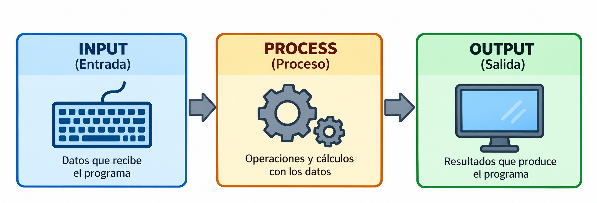

<details class="indice-tema" open>
<summary>Contenidos</summary>

[[toc]]

</details>


::: objetivos Escribir información y entender qué recibe el navegador

- Generar salida utilizando `echo` y `print`.
  - Utilizar la sintaxis corta `<?= ... ?>`.
  - Comprender cómo PHP trabaja con cadenas de caracteres.
  - Diferenciar comillas simples y dobles.
  - Utilizar secuencias de escape.
  - Generar texto con formato mediante `printf()`.
  - Inspeccionar variables con `print_r()` y `var_dump()`.
  - Utilizar Xdebug para mejorar la información de depuración.

:::

# Escribiendo

Una de las típicas acciones de un programa es  **generar una respuesta**.



Para hacerlo en php, disponemos de dos instrucciones del lenguaje y una serie de funciones

<PhpRunner>

```php
    <?php
    
    echo "Hola mundo";
        ?>
```        

</PhpRunner>

Pero conviene entender qué significa realmente **escribir** en una aplicación PHP.

::: recuerda PHP genera la respuesta

PHP se ejecuta **en el servidor**.

Cuando hacemos:

```php
echo "<h1>Hola</h1>";
```

PHP no dibuja un título en la pantalla.

Simplemente genera este texto:

```html
<h1>Hola</h1>
```

Ese contenido se envía en la respuesta HTTP y será posteriormente el **navegador** quien interprete el HTML y lo represente visualmente.

:::


Para generar salida e inspeccionar información en PHP disponemos de **construcciones del lenguaje** y **funciones incorporadas**:

- **Construcciones del lenguaje**
  - `echo`: muestra una o varias expresiones.
  - `print`: muestra una expresión y devuelve `1`.
  - `<?= ... ?>`: sintaxis abreviada de `echo`.

- **Funciones incorporadas de PHP**
  - `printf()`: muestra texto con formato.
  - `sprintf()`: genera y retorna una cadena con formato sin mostrarla.
  - `print_r()` [^retorno]: muestra información legible de variables, especialmente arrays y objetos.
  - `var_dump()`: muestra el tipo y el valor de una o varias variables.
  - `var_export()` [^retorno]: genera  una representación de una variable como código PHP. 
  
[^retorno]:ambas funciones, admiten un segundo argumento booleano que, si es `true`, hace que devuelvan el resultado como un string en lugar de mostrarlo.

## Primitivas del lenguaje
Como hemos comentado tenemos 2 primitivas y una exprsión que permite abreviarlas:


### echo


::: definicion echo | fa-solid fa-terminal

`echo` permite enviar una o varias expresiones a la salida generada por PHP.

Aunque su aspecto pueda recordar al de una función, **`echo` no es una función**, sino una construcción propia del lenguaje PHP.

Por ese motivo, normalmente se escribe **sin paréntesis**:

:::


<PhpRunner>

```php
<?php
echo "Hola Mundo"; 
?>
```

</PhpRunner>

También podemos encontrar:

<PhpRunner>

```php
<?php
echo ("Hola"); 
?>
```

</PhpRunner>

Esos paréntesis no convierten a `echo` en una función. En realidad forman parte de la expresión que estamos mostrando.


Una característica particular de `echo` es que permite escribir <color>varios argumentos</color> separados mediante comas. Esto simplemente es una característica del operador, pero no aporta mucho.

<PhpRunner>

```php
<?php
$nombre = "Ana";
$edad = 24;
echo "Nombre: ", $nombre, " - Edad: ", $edad; 
?>
```

</PhpRunner>

El resultado será:

```text
Nombre: Ana - Edad: 24
```

No es una utilidad interesante, pero existe en la primitiva. También podríamos concatenar los valores:


<PhpRunner>

```php
<?php
echo "Nombre: " . $nombre . " - Edad: " . $edad; 
?>
```
</PhpRunner>


Más adelante veremos con detalle el operador de concatenación `.` (punto).

::: recuerda `echo` no devuelve ningún valor

`echo` genera salida, pero **no devuelve un resultado**.

Por tanto, esto no es válido:

<PhpRunner>

```php
<?php

$retorno = echo "Hola";
?>
```

</PhpRunner>
PHP producirá un error de sintaxis.

:::


::: practica Probando echo | fa-solid fa-keyboard

Antes de ejecutar el código, intenta averiguar exactamente qué aparecerá:

<PhpRunner>

```php
    <?php
    $nombre = "Laura";
    $edad = 22;
    
    echo "Hola ", $nombre;
    echo " tienes ", $edad, " años";
    ?>
```
</PhpRunner>

Prueba ahora a:

1. Cambiar los valores de las variables.
2. Añadir más argumentos al segundo `echo`.
3. Sustituir las comas por concatenaciones utilizando `.`.
4. Comprobar si obtienes exactamente la misma salida.

:::


### La sintaxis corta `<?= ?>`

Cuando PHP se mezcla con HTML existe una forma especialmente cómoda de escribir un valor:

```php
<?= $variable ?>
```

Es equivalente a:

```php
<?php echo $variable; ?>
```

Por ejemplo:

<PhpRunner>

```php
<?php
$usuario = "Manuel";
?>

<h1>Bienvenido <?= $usuario ?></h1>
```

</PhpRunner>

Otro ejemplo:

<PhpRunner>

```php
<p>Hoy es <?= date("d/m/Y") ?></p>
```

</PhpRunner>

::: recuerda `<?= ... ?>`

La construcción:

```php
<?= expresión ?>
```

es una forma abreviada de:

```php
<?php echo expresión; ?>
```

Resulta especialmente útil cuando estamos construyendo **vistas HTML**.

La utilizaremos muchísimo más adelante.

:::


::: pregunta ¿Qué versión resulta más legible?

Compara:

```php
<?php echo "<h1>Bienvenido " . $usuario . "</h1>"; ?>
```

con:

```php
<h1>Bienvenido <?= $usuario ?></h1>
```

¿Cuál permite distinguir mejor el HTML del código PHP?

:::


### `print`

PHP dispone también de `print`.

```php
<?php

print "Hola mundo";
```

A primera vista se comporta prácticamente igual que `echo`, pero existen dos diferencias:

- `print` admite **una única expresión**.
    - `print` devuelve siempre el valor entero `1`.

Por ejemplo:

<PhpRunner>

```php
<?php
 ```php
<?php

$resultado = print "Hola mundo";

var_dump($resultado);
```
?>

</PhpRunner>

Primero se escribirá:

```text
Hola mundo
```

y `$resultado` contendrá:

```text
int(1)
```

Esto permite utilizar `print` dentro de una expresión, aunque en código habitual rara vez necesitaremos hacerlo.

###  `echo` Vs `print`

| Característica | `echo` | `print` |
|---|---|---|
| Es una función | No | No |
| Es una construcción del lenguaje | Sí | Sí |
| Varios argumentos | Sí | No |
| Devuelve un valor | No | Sí, siempre `1` |
| Uso habitual | Muy frecuente | Menos frecuente |

::: recuerda ¿echo o print?

En nuestros programas utilizaremos normalmente **`echo`**.

No porque la diferencia de rendimiento sea relevante, sino porque:

- es la construcción más habitual para generar salida;
    - admite varios argumentos;
    - expresa claramente que únicamente queremos enviar información a la salida.

`print` conviene conocerlo, pero aparecerá mucho menos en nuestro código.

:::


::: practica echo frente a print | fa-solid fa-keyboard

Ejecuta:

<PhpRunner>

```php

    <?php
    echo "Uno", " - ", "Dos";
    
    echo "\n";
    
    print "Tres";
    
    $retorno = print " - Cuatro";
    
    echo "\n";
    var_dump($retorno);
    ?>
```


</Phprunner>


Comprueba:

- que `echo` acepta varios argumentos;
    - que `print` solo recibe una expresión;
    - qué valor queda almacenado en `$retorno`.

Después prueba:

```php
print "Uno", "Dos";
```

¿Qué ocurre?

:::


# `printf()`: salida con formato

Cuando necesitamos controlar el formato de determinados valores podemos utilizar `printf()`.

A diferencia de `echo` y `print`, **`printf()` sí es una función**.

Por ejemplo:

<PhpRunner>

```php
    <?php
    
    $precio = 5.25251;
    
    printf("Precio: %.2f €", $precio);
    ?>
```
</PhpRunner>


La salida será:

```text
Precio: 5.25 €
```

`%.2f` indica que queremos mostrar un número decimal con **dos cifras decimales**.


<color> Especificadores habituales</color>

| Especificador | Representación |
|---|---|
| `%s` | String |
| `%d` | Entero decimal |
| `%u` | Entero decimal sin signo |
| `%f` | Número decimal |
| `%e` | Notación científica |
| `%b` | Binario |
| `%o` | Octal |
| `%x` | Hexadecimal en minúsculas |
| `%X` | Hexadecimal en mayúsculas |
| `%c` | Carácter |

Ejemplo:

<PhpRunner>

```php
<?php

$numero = 42;

printf("Decimal: %d\n", $numero);
printf("Binario: %b\n", $numero);
printf("Octal: %o\n", $numero);
printf("Hexadecimal: %X\n", $numero);
?>
```

</PhpRunner>  


::: practica Formateando números | fa-solid fa-keyboard

<PhpRunner>

```php

<?php
$numero = 42;
$precio = 15.6789;

printf("Decimal: %d\n", $numero);
printf("Binario: %b\n", $numero);
printf("Octal: %o\n", $numero);
printf("Hexadecimal: %X\n", $numero);

echo "\n";

printf("Precio sin formato: %f\n", $precio);
printf("Precio con 2 decimales: %.2f\n", $precio);
```

</Phprunner>

Modifica los valores y comprueba los distintos formatos.

¿Qué diferencia observas entre `%f` y `%.2f`?
:::


# Funciones de debug:  Inspeccionando variables

`echo` está pensado principalmente para **generar salida**.

Pero mientras desarrollamos un programa muchas veces necesitamos responder a preguntas distintas:

- ¿qué contiene esta variable?
    - ¿qué tipo tiene?
    - ¿qué elementos contiene este array?
    - ¿qué estructura tiene este objeto?

Para eso PHP dispone de herramientas específicas de inspección:
* print_r[^retorno]
* var_dump
* var_export[^retorno]


## `print_r()`

`print_r()` muestra información de una variable de una forma relativamente legible.

Es especialmente útil con arrays y objetos.

```php
<?php

$frutas = ["manzana", "plátano", "naranja"];

print_r($frutas);
```

La salida será similar a:

```text
Array
(
    [0] => manzana
    [1] => plátano
    [2] => naranja
)
```

Con `echo` no podríamos inspeccionar directamente el contenido de un array de esta forma.


<color> Recuperar el resultado de `print_r()`</color>

Normalmente `print_r()` escribe directamente el resultado:

```php
print_r($frutas);
```

Pero dispone de un segundo argumento.

Si indicamos `true`:

```php
$resultado = print_r($frutas, true);
```

en lugar de mostrar la información, **la devuelve como un string**.

Después podríamos hacer:

```php
echo $resultado;
```


:::practica Inspeccionando un array | fa-solid fa-keyboard


Añade nuevos elementos al array y observa cómo cambia la salida.
:::

<PhpRunner>

```php

<?php
$alumno = [
"nombre" => "Laura",
"edad" => 22,
"curso" => "DAW"
];

print_r($alumno); 
?>
```

</PhpRunner>


Añade nuevos elementos al array y observa cómo cambia la salida.

:::


## `var_dump()`

`var_dump()` proporciona más información que `print_r()`.

No muestra únicamente el valor: también informa del **tipo de dato**.


<PhpRunner>

```php
<?php
 $nombre = "Ana";
$edad = 23;
$nota = 8.5;
$aprobado = true;

var_dump($nombre);
var_dump($edad);
var_dump($nota);
var_dump($aprobado);

?>
```

</PhpRunner>

Ejecuta y observa la salida Observa que `var_dump()` nos permite distinguir los tipos de los valores 
(42, vs "42"), Aunque visualmente puedan parecer iguales:

<PhpRunner>

```php
    <?php
        var_dump(42);
        var_dump("42");
    ?>
```

</PhpRunner>


::: recuerda `print_r()` frente a `var_dump()`

`print_r()` resulta cómodo para **ver la estructura y contenido** de arrays y objetos.

`var_dump()` proporciona además información sobre los **tipos de datos**.

Durante el desarrollo utilizaremos con frecuencia `var_dump()` para entender qué está ocurriendo en nuestro programa.

Ninguna de las dos está pensada para generar la interfaz final que verá el usuario.

:::


::: practica ¿Son realmente iguales? | fa-solid fa-keyboard

Ejecuta:

<PhpRunner>

```php
    <?php
        $valores = [
                42,
                "42",
                3.14,
                true,
                false,
                null,
                "Hola"
        ];

print_r($valores);

echo "\n----------------\n";

var_dump($valores);

    ?>
```

</PhpRunner>

Compara ambas salidas.

¿Qué información proporciona `var_dump()` que no resulta tan evidente con `print_r()`?

:::

### Mejorando `var_dump()` con Xdebug

PHP incluye `var_dump()` de forma nativa.

No necesitamos instalar nada para utilizarlo.

Sin embargo, durante el desarrollo podemos instalar **Xdebug**, una extensión de PHP que añade distintas herramientas de depuración.

Entre ellas se encuentra una presentación mejorada de `var_dump()`.

::: definicion Xdebug | fa-solid fa-bug

**Xdebug** es una extensión para PHP orientada al desarrollo y la depuración.

Puede proporcionar, entre otras funcionalidades:

- una presentación mejorada de `var_dump()`;
- información más detallada sobre errores;
- trazas de ejecución;
- depuración paso a paso desde un IDE;
- análisis de cobertura de tests;
- profiling.

No forma parte del núcleo de PHP: debemos instalarlo como una extensión.

:::


### Instalar Xdebug en nuestro contenedor

Si nuestra imagen parte de:

```dockerfile
FROM php:8.5-apache
```

podemos instalar Xdebug mediante PECL:

```dockerfile
FROM php:8.5-apache

RUN pecl install xdebug \
    && docker-php-ext-enable xdebug
```

Después podemos añadir su configuración:

```dockerfile
RUN echo "xdebug.mode=develop" \
    > /usr/local/etc/php/conf.d/99-xdebug.ini
```

El Dockerfile quedaría:

```dockerfile
FROM php:8.5-apache

RUN pecl install xdebug \
    && docker-php-ext-enable xdebug

RUN echo "xdebug.mode=develop" \
    > /usr/local/etc/php/conf.d/99-xdebug.ini
```

Reconstruimos la imagen:

```bash
docker compose build
```

y levantamos nuevamente los contenedores:

```bash
docker compose up -d
```


 <color>Comprobar que Xdebug está instalado</color>

Podemos comprobar los módulos cargados:

```bash
docker compose exec web php -m
```

Entre ellos debería aparecer:

```text
xdebug
```

También podemos consultar directamente la información de la extensión:

```bash
docker compose exec web php --ri xdebug
```

O desde una página PHP:

```php
<?php

xdebug_info();
```

:::tip
En nuestro componente de ejecución <color>sandbox</color> que tenemos para nuestros apuntes, no está instalado xdebug, por lo que no lo podremos probar 
:::
::: pageinfo ¿Por qué usamos `xdebug.mode=develop`?

Xdebug tiene diferentes modos de funcionamiento.

El modo:

```ini
xdebug.mode=develop
```

activa sus herramientas de ayuda durante el desarrollo, entre ellas la presentación mejorada de `var_dump()`.

Más adelante, cuando configuremos la depuración paso a paso con PhpStorm o VS Code, podremos utilizar también:

```ini
xdebug.mode=develop,debug
```

Instalar Xdebug y **activar el depurador paso a paso** son, por tanto, dos cosas diferentes.

:::


### `var_dump()` con Xdebug

Nuestro código PHP no cambia:

```php
<?php

$alumno = [
    "nombre" => "Laura",
    "edad" => 22,
    "modulos" => [
        "Servidor",
        "Cliente",
        "Despliegue"
    ]
];

var_dump($alumno);
```

Seguimos utilizando la función estándar:

```php
var_dump($alumno);
```

pero Xdebug puede mejorar su representación mostrando la estructura de los datos de una forma más cómoda durante el desarrollo.

::: recuerda El código no depende de Xdebug

Esto es importante:

```php
var_dump($variable);
```

es PHP.
**Xdebug no crea `var_dump()`**.

Lo que hace Xdebug es mejorar su comportamiento y presentación cuando la extensión está instalada y configurada adecuadamente.

Por tanto, nuestro código funcionaría igual  aunque Xdebug no esté instalado.

:::


# ¿Qué herramienta utilizo?

Podemos resumir lo visto de esta forma:

| Necesito... | Utilizaría |
|---|---|
| Mostrar texto | `echo` |
| Insertar un valor dentro de HTML | `<?= ... ?>` |
| Mostrar texto mediante otra construcción del lenguaje | `print` |
| Dar formato a números o cadenas | `printf()` |
| Examinar rápidamente un array u objeto | `print_r()` |
| Conocer valor **y tipo** de una variable | `var_dump()` |
| Mejorar la depuración durante el desarrollo | Xdebug |


Realiza las siguientes pruebas:

1. Muestra un mensaje utilizando `echo`.
2. Inserta `$nombre` dentro de un string utilizando comillas dobles.
3. Repite la operación utilizando comillas simples y explica la diferencia.
4. Utiliza `\n` e inspecciona el código fuente generado.
5. Genera un salto visual utilizando `<br>`.
6. Muestra `$nota` con exactamente dos decimales utilizando `printf()`.
7. Inspecciona `$modulos` utilizando `print_r()`.
8. Inspecciona todas las variables utilizando `var_dump()`.

No te limites a ejecutar el código.

Para cada caso intenta identificar:

> **qué ejecuta PHP, qué salida genera y qué termina interpretando el navegador.**


::: finalidad Al terminar esta página deberías poder explicar…

- Por qué `echo` y `print` no son funciones.
- Qué diferencia existe entre `echo` y `print`.
- Para qué sirve `<?= ... ?>`.
- Qué diferencia existe entre strings con comillas simples y dobles.
- Qué significa interpolar una variable.
- Para qué sirven las secuencias de escape.
- Por qué `\n` y `<br>` no son equivalentes.
- Para qué utilizarías `printf()`.
- Qué diferencia existe entre `print_r()` y `var_dump()`.
- Qué aporta Xdebug a `var_dump()`.
- Qué parte de la salida genera PHP y qué parte interpreta posteriormente el navegador.

:::


::: referencias Documentación oficial

- [PHP: echo](https://www.php.net/manual/es/function.echo.php)
- [PHP: print](https://www.php.net/manual/es/function.print.php)
- [PHP: Strings](https://www.php.net/manual/es/language.types.string.php)
- [PHP: printf](https://www.php.net/manual/es/function.printf.php)
- [PHP: print_r](https://www.php.net/manual/es/function.print-r.php)
- [PHP: var_dump](https://www.php.net/manual/es/function.var-dump.php)
- [Xdebug](https://xdebug.org/)
- [Xdebug: Development Helpers](https://xdebug.org/docs/develop)

:::


# Heredoc vs Nowdoc

**Heredoc** y **Nowdoc** son dos formas alternativas de definir cadenas de texto (*strings*) en PHP.

Ambas permiten escribir **cadenas multilínea**, delimitadas por una etiqueta que nosotros elegimos, sin necesidad de concatenar cadenas ni introducir `\n` para los saltos de línea.

La principal diferencia es la **interpretación de caracteres especiales**:

- **Heredoc**: funciona como las **comillas dobles (`"`)**. Interpreta secuencias de escape e interpola variables.
- **Nowdoc**: funciona como las **comillas simples (`'`)**. No interpola variables y trata las secuencias de escape literalmente.

## Heredoc

Se utiliza `<<<` seguido de una etiqueta identificadora.

```php
$nombre = "Ana";

$texto = <<<TEXTO
Hola $nombre.
Bienvenida al curso de PHP.
Esta es una cadena con varias líneas.
TEXTO;

echo $texto;
```

**Resultado:**

```text
Hola Ana.
Bienvenida al curso de PHP.
Esta es una cadena con varias líneas.
```

Observa que `$nombre` se sustituye por su valor, igual que ocurre con las comillas dobles.

## Nowdoc

Se utiliza `<<<` seguido de una etiqueta identificadora **entre comillas simples**.

```php
$nombre = "Ana";

$texto = <<<'TEXTO'
Hola $nombre.
Bienvenida al curso de PHP.
Esta es una cadena con varias líneas.
TEXTO;

echo $texto;
```

**Resultado:**

```text
Hola $nombre.
Bienvenida al curso de PHP.
Esta es una cadena con varias líneas.
```

En este caso, `$nombre` se muestra literalmente, sin interpolación.

## ¿Cuándo utilizarlos?

Son especialmente útiles para:

- **Textos largos o multilínea**, evitando concatenaciones.
- **Sentencias SQL**, que pueden ocupar varias líneas.
- **Fragmentos HTML**, sin necesidad de escapar las comillas dobles.
- **Textos que combinan comillas simples y dobles**, facilitando su escritura y lectura.

::: tip Recuerda
- **Heredoc** → equivale a utilizar comillas dobles (`"`).
- **Nowdoc** → equivale a utilizar comillas simples (`'`).

La etiqueta de apertura y la de cierre deben coincidir. La etiqueta de cierre debe comenzar al principio de una línea o tener una indentación válida, y no debe quedar más indentada que el contenido.
:::
