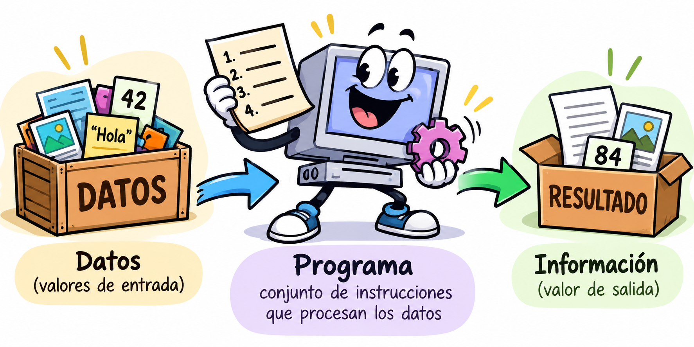

# Las declaraciones en php
<objetivos>
Declarar es una de las instrucciones más importantes

En php ¿Declaramos variables?

Qué elementos debemos/podemos declarar

Conocer las características del tipado de PHP.

Identificar los principales tipos de datos de PHP.

Representar números enteros en diferentes bases.

Cómo usamos los elementos declarados
</objetivos>


<details class="indice-tema" open>
<summary>Contenidos</summary>

[[toc]]

</details>


## 1. Introducción: declaraciones y variables

:::pageinfo La declaracción |  fa-solid fa-book-bookmark 
* Es una <color>acción</color> o instrucción por la que _reservaremos memoria para almacener valores de un determinado elemento_ que posteriormente utilizaremos.

Un programa es <color>un conjunto de instrucciones</color> que operan <color>con valores o datos</color>, o invocan a funciones que previamente habré declarado.


___

* <color>Una declaración</color>, aparentemente no realizan una acción directa, sirven para alamcenar en memoria el elemento declarado
* Posteriormente podremos referenciarlo, invocarlo; en general, <color>trabajar con el elemento declarado</color>

:::


En PHP, al igual que en otros lenguajes de programación, podemos declarar o definir diferentes elementos:

- **Variables:** identificadores que corresponden a posiciones de memoria dondes se almacenan valores que pueden cambiar durante la ejecución.
- **Constantes:** identifican valores que no pueden modificarse una vez definidos.
- **Funciones:** bloques de código reutilizables que realizan una tarea.
- **Clases:** estructuras de códogio  que definen atributos y métodos para crear objetos.
- **Objetos**: A partir de las clases podemos **crear objetos o instanciar  (instancias)**, que utilizaremos para trabajar con sus atributos y métodos. (Es mas una instanciación que delcaración)

## 1.1. Las variables:  Declaración, inicialización y asignación.

:::definicion Variable | fa-solid fa-code
Una variable es un <color>identificador</color> que corresponde a <color>una posición de memoria</color> en cuyo contenido podremos almacenar <color>un valor de un determinado tipo</color>, el cual puede ser modificado durante la ejecución de un programa.
:::

Debemos distinguir tres conceptos básicos:

- **Declaración:** introduce un identificador en un programa, como el nombre de una variable, función o clase.
- **Inicialización:** proporciona un valor inicial a una variable.
- **Asignación:** establece o modifica el valor de una variable.

No en todos los lenguajes se declaran los elementos de la misma manera.

```java
int edad;      // Declaración
edad = 25;     // Primera asignación
edad = 30;     // Nueva asignación
```

En PHP no es necesario declarar previamente las variables mediante una instrucción específica, sino que esta ocurre la primera vez que asignamos un valor.

```php
$edad = 25;    // Creación e inicialización
$edad = 30;    // Nueva asignación
```


<color>Una variable va a ser de un tipo determinado</color>

Un **tipo de dato** es una clasificación de valores que determina sus características (números, caracteres,...)y las operaciones que podemos realizar con ellos (sumar, concatenar, ...).

Por ejemplo:

- Un número entero permite realizar operaciones aritméticas.
- Una cadena permite trabajar con caracteres y concatenar textos.
- Un booleano representa un valor lógico verdadero o falso.

Cada lenguaje de programación establece sus propias reglas para identificar las variables.

::::definicion Identificador de una variable  | fa-solid fa-id-badge 
**En PHP, una variable debe comenzar por <color>el símbolo `$`</color>, seguido de un nombre válido:**

- Debe comenzar por una letra o un guion bajo (`_`).
- Puede contener letras, números y guiones bajos.
- No puede comenzar por un número.
- Distingue entre mayúsculas y minúsculas.

La siguiente expresión representa de forma simplificada estas reglas:

```text
$[a-zA-Z_][a-zA-Z0-9_]*
```
:::pageinfo Caracteres extendidos bytes comprendidos entre 0x80 y 0xFF|fa-solid fa-language
PHP también permite estos caracteres, pero no se recomienda su uso
| Categoría | Ejemplos |
|---|---|
| Vocales acentuadas | á, é, í, ó, ú, Á, É, Í, Ó, Ú |
| Otras letras españolas | ñ, Ñ, ü, Ü |
| Letras de otros idiomas | à, è, ê, ç, ö, ä, å, ø |
| Letras griegas | α, β, γ, π, Ω |
| Letras cirílicas | Д, Ж, Я |
| Caracteres asiáticos | 中, 文, 日, 本 |
| Algunos símbolos Unicode | €, ©, ✓, ★ |

Por lo que estos identificadores serían válidos
```php
$año = 2026;
$π = 3.14159;
$日本語 = "Japonés";
$precio€ = 100;
```
:::
::::


<color>Lenguajes de  tipado dinámico Vs Estático</color>

PHP es un lenguaje de **tipado dinámico**. Es esta una característica importante del lenguaje

Esto significa que el tipo asociado a una variable se determina a partir de su valor durante la ejecución del programa. Una variable en php siempre tiene tipo (*lenguaje tipado*)El tipo podrá cambiar si cambia su valor (*tipado dinámico*)

```php
$dato = 25;       // int
$dato = "Hola";   // string
$dato = true;     // bool
```

Observa que la misma variable puede contener valores de distintos tipos.

:::pageinfo Tipado dinámico Vs Estático |fa-solid fa-arrows-rotate 


<div class="tabla-comparativa">

| Tipado estático | Tipado dinámico |
|---|---|
| Las variables se declaran **explíciatamente**. | Las variables **se usan directamente**. |
| El tipo de la variable **no se puede modificar** durante la ejecución. | El tipo de una variable de **pendende de su valor**, y **puede cambiar en cualquier momento**. |
| Ejemplos: Java, C#. | Ejemplos: **PHP**, Python, **Javascript**. |

</div>

::: warning ⚠️ Tipado fuerte y débil
**Tipado estático/dinámico** y **tipado fuerte/débil** no son equivalentes.

La distinción entre tipado fuerte y débil se relaciona con las conversiones implícitas y las operaciones permitidas entre tipos.

PHP permite determinadas conversiones automáticas entre tipos, pero también dispone de declaraciones de tipos y del modo `strict_types`.

Por tanto, es más preciso describir PHP como un lenguaje de **tipado dinámico**, en lugar de identificarlo simplemente como un lenguaje de tipado débil.
:::

## Principales tipos de datos de PHP

| Tipo | Descripción | Ejemplo |
|---|---|---|
| `int` | Número entero | `25` |
| `float` | Número en coma flotante | `3.14` |
| `string` | Cadena de caracteres | `"Hola"` |
| `bool` | Valor lógico | `true` |
| `null` | Ausencia de valor | `null` |
| `array` | Colección de valores | `[1, 2, 3]` |
| `object` | Instancia de una clase | `new Persona()` |

En este apartado nos centraremos en los tipos escalares (`int`, `float`, `string`, `bool`) y en `null`.

Los arrays y los objetos se estudiarán más adelante.


**Ejemplos válidos:**

```php
$edad = 25;
$nombreUsuario = "Ana";
$_contador = 10;
$precio_total = 125.50;
```

**Ejemplos incorrectos:**

```php
edad = 25;       // Falta el símbolo $
$5edad = 25;     // No puede comenzar por número
$mi-edad = 25;   // El guion no forma parte del identificador
```

::: warning
PHP distingue entre mayúsculas y minúsculas en los nombres de variables.

```php
$edad = 25;
$Edad = 30;

echo $edad; // 25
echo $Edad; // 30
```

Son dos variables diferentes.
:::

<color>Tipo de una variable</color>

PHP dispone de funciones que permiten conocer el tipo y el valor de una variable.

**`get_debug_type()`** Vs **`gettype()`** 

Devuelve el nombre del tipo como una cadena.

```php
$edad = 25;

echo get_debug_type($edad); // int
echo gettype($edad); // integer
```
Ambas retornan el tipo del valor:

<div class="tabla-comparativa">

| gettype() | get_debug_type() |
|---|---|
| **integer** | **int** |
| **double** | **float** |
| **boolean** | **bool** |
| **string** | **string** |
| **NULL** | **null** |
| **object** | **Alumno** (Aquí muestra el nombre de la clase del objeto) |

</div>

**`var_dump()`**

Muestra información sobre el tipo y el valor de una variable.

```php
$edad = 25;
$nombre = "Ana";

var_dump($edad);   // int(25)
var_dump($nombre); // string(3) "Ana"
```

::: tip
`var_dump()` es especialmente útil durante el desarrollo para inspeccionar variables.

No está pensada para presentar información al usuario final.
:::

**Funciones `is_*()`**

Permiten comprobar si un valor pertenece a un tipo determinado.

```php
$edad = 25;

var_dump(is_int($edad));    // bool(true)
var_dump(is_float($edad));  // bool(false)
var_dump(is_string($edad)); // bool(false)
```

También existen `is_bool()`, `is_null()`, `is_array()` e `is_object()`.

