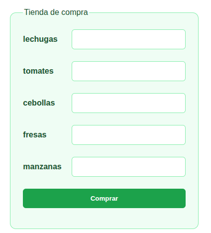

Partiendo del siguiente array de productos:
Vamos a hacer una tienda dónde visualicemos :

* Un formulario con los productos a comprar

* Un informe con la factura y los productos que nos quedan 


```php
<?php
$productos = [
    'lechuga' => ['unidades' => 200, 'precio' => 0.90],
    'tomates' => ['unidades' => 2000, 'precio' => 2.15],
    'cebollas' => ['unidades' => 3200, 'precio' => 0.49],
    'fresas' => ['unidades' => 4800, 'precio' => 4.50],
    'manzanas' => ['unidades' => 2500, 'precio' => 2.10],
];
``` 
<details>
<summary>🎨 CSS para dar estilo a la tienda</summary>

Puedes utilizar estas clases CSS para presentar el formulario y la factura.

```css
/* Contenedor de la tienda */
.tienda {
    max-width: 550px;
    margin: 30px auto;
    padding: 25px;
    background: #f0fdf4;
    border: 1px solid #86efac;
    border-radius: 12px;
    font-family: Verdana, sans-serif;
    color: #14532d;
}

/* Título */
.tienda h2 {
    text-align: center;
    color: #166534;
}

/* Formulario */
.tienda form {
    display: flex;
    flex-direction: column;
    gap: 12px;
}

.tienda label {
    font-weight: bold;
}

.tienda input,
.tienda select {
    padding: 10px;
    border: 1px solid #86efac;
    border-radius: 6px;
    font-size: 1rem;
    background: white;
    color: #222;
}

/* Botón de compra */
.tienda button {
    padding: 12px;
    background: #16a34a;
    color: white;
    border: none;
    border-radius: 6px;
    cursor: pointer;
    font-weight: bold;
}

.tienda button:hover {
    background: #15803d;
}

/* Factura */
.factura {
    margin-top: 20px;
    padding: 15px;
    background: white;
    border: 1px solid #bbf7d0;
    border-radius: 8px;
    color: #222;
}

/* Mensajes */
.error {
    color: #b91c1c;
    font-weight: bold;
}

.exito {
    color: #15803d;
    font-weight: bold;
}
.form-group{
    display: flex;
    justify-content: space-between;
    align-items: center;
    gap: 20px;
    margin-bottom: 12px;
}
.informes {
    display: flex;
    justify-content: center;
    align-items: flex-start;
    gap: 24px;
    margin-top: 24px;
}

.informes .factura {
    min-width: 250px;
}
```

</details>