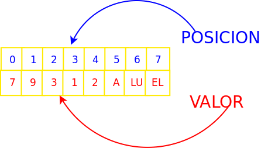
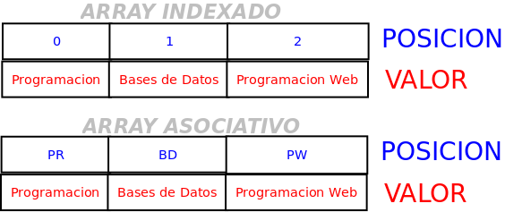
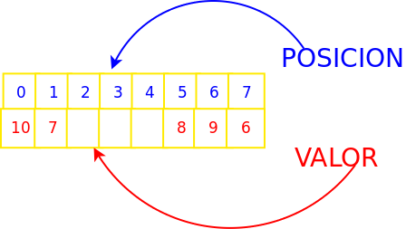
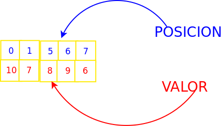

---
---


<details class="indice-tema" open>
<summary>Contenidos</summary>

[[toc]]

</details>

:::objetivos Qué veremos aquí


:::

# Introducción a los Arrays

<color>Es una estructura compuesta de datos.</color>
* Un array en php va a ser una colección de elementos (datos) accesibles a través de la variable.

* Cada elemento puede ser de cualquier tipo
 
* Los elementos del array se almacenan a partir de un índice  que también puede ser de cualquier tipo simple
En php existe una primera clasificación  según el valor que tengan en el índice:
<color>Array Indexado: los índices son números que expresan la posición.</color>

<PhpRunner>

```php
<?php
$notas[0]= 10;
$notas[1]= 9;
?>
```
</PhpRunner>

<color>Array Asociativo: los índices pueden ser cualquier valor,</color> normalmente con significado semático.

<PhpRunner>

```php
<?php
$capital['francia']= 'paris';
$notas['españa']= 'madrid';
?>
```

</PhpRunner>

Un **array** es una estructura de datos que permite almacenar varios valores en una única variable.

:::definicion Los arrays en PHP | fa-solid fa-code
Un **array** es un tipo de dato compuesto cuyos elementos se identifican mediante una **clave o índice**, que puede ser un número entero (`int`) o una cadena de texto (`string`).
:::

Los arrays en PHP son estructuras muy **flexibles y dinámicas**:

* Pueden almacenar <color>valores de distintos tipos de datos</color>, incluso otros arrays.
* Pueden <color>crecer o reducirse durante la ejecución</color>, sin necesidad de declarar previamente su tamaño.
* Sus <color>índices pueden ser números enteros o cadenas de texto</color>.

  
 ___
- A diferencia de los arrays tradicionales de algunos lenguajes, los **arrays de PHP son estructuras dinámicas**, implementadas internamente como **tablas hash ordenadas**. 

- Los arrays de PHP son especialmente **potentes y flexibles**, ya que permiten representar estructuras que en otros lenguajes suelen diferenciarse, como **arrays, listas, diccionarios o mapas**. Sus elementos se organizan en parejas **clave → valor**, donde las claves pueden ser números enteros o cadenas de texto. Esta característica facilita también el trabajo con datos en formato **JSON**, especialmente con los objetos JSON, que pueden convertirse en arrays asociativos de PHP.

## Array indexado vs array asociativo
Para acceder a los elementos de un array utilizamos una clave o índice. En PHP, esta clave no tiene por qué representar la posición que ocupa el elemento.

Habitualmente distinguimos dos formas de utilizar los arrays:

Array indexado: utiliza claves numéricas enteras. Cuando no especificamos las claves, PHP las genera automáticamente, comenzando normalmente por cero.

Array asociativo: utiliza claves con un significado propio, generalmente cadenas de texto, que permiten identificar los valores por su nombre.



Podemos añadir elementos con claves de texto a un array indexado en cualquier momento, combinando así claves numéricas y asociativas.

:::pageinfo Arrays indexados y asociativos | fa-solid fa-key
En realidad, PHP utiliza **un único tipo de array**. La diferencia entre indexado y asociativo depende de las claves utilizadas. 

Cuando no indicamos una clave, PHP genera automáticamente una clave entera siguiendo <color>sus reglas de indexación</color> (Crea un valor numérico incrementando el último que se hubiera utilizado).
:::

<PhpRunner>

```php
<?php
// array numérico
$modulos1 = array(0 => "Programación",
                  1 => "Bases de datos",
                  9 => "Desarrollo web en entorno servidor");
 
// array asociativo
$modulos2 = array("PR" => "Programación",
                  "BD" => "Bases de datos", 
                  "DWES" => "Desarrollo web en entorno servidor");
var_dump($modulos1);
var_dump($modulos2);
$modulos1 = [0 => "Programación",
                  1 => "Bases de datos", 
                  9 => "Desarrollo web en entorno servidor"];
// array asociativo
$modulos2 = ["PR" => "Programación",
                  "BD" => "Bases de datos", 
                  "DWES" => "Desarrollo web en entorno servidor"];
var_dump($modulos1);
var_dump($modulos2);
?>
```

</PhpRunner>

Como ya hemos visto. los arrays en php se pueden clasifican en función de la clave que llevan:

**Clave numérica posicional** ( <color>Array Indexado</color>) : La clave especifica la posición de cada elemento.

**Clave con valor** (<color>Array Asociativo</color>): La clave tiene un significado semántico y tiene asociado un valor. 

**_En los Arrays indexados, el índice empieza por 0._**

El contenido de un elemento de un array puede ser cualquier valor, incluido otro array, puediendo fácilmente construir estructuras mas complejas o arrays N-dimensionales, como veremos en ejemplos posteriores.

### Crear un array
A la hora de trabajar con arrays, hay que saber operar con ellos:
* **_Crear_** o definir un array.
* _**Asignar**_, agregar valores al array.
* _**Leer**_ elementos del array.
* _**Borrar**_ elementos del array.


Para crear un array lo podemos hacer:
* Con el  operador <color>array()</color>;
* A partir de la versión 5.3 se puede (y recomienda) usar directamente <color>el operador []</color>

<PhpRunner>

```php
<?php
/*
Creamos una variable '''array''' llamada ''miArray'' vacía.
Dos formas equivalentes:
*/
$miArray = array();
$miArray = [];
/*
Creamos un array indexado de ciudades
*/
$miArray = array("Burgos","Zaragoza","Huesca", "Teruel","Soria");
$miArray = ["Burgos","Zaragoza","Huesca", "Teruel","Soria"];
var_dump($miArray);
?>
```

</PhpRunner>


### Escribiendo:  Añadir y modificar elementos
Para escribir en un array, simplemente especificamos la clave entre corchetes y le asignamos un valor. Para leer un elemento, utilizamos la misma sintaxis.

**Si la clave no existe, PHP la creará automáticamente. Si la clave ya existe, el valor se sobrescribirá.**

<PhpRunner>

```php
<?php
$notas =[];
$notas[]=10; 
$notas[]=7;
$notas[5]= 8;
$notas [] =9;
$notas [] =6;
var_dump($notas);
?>
```
</PhpRunner>
<div style="text-align: center;">
  <color>Podríamos pensar que crearía esta estructura</color>

  
</div>

<div style="text-align: center;">
  <color>Lo que realmente creará :</color>


</div>
Tener cuidad con añadir nuevos elementos no es lo mismo que una asignación.

<PhpRunner>

```php
<?php
$notas = [1,2,3,4,5]; //Creo un array con 5 notas
$notas[5] = 6; //añado un nuevo elemento en la posición 5=> 6

$notas = [9]; //Estoy creando un nuevo array con una sola nota 0=>9

?>
```
</PhpRunner>

Si quiero añadir varios elementos a un array, puedo hacerlo con funciones específicas (hablamos de añadir elementos a un array, no de crear un nuevo array a a partir de dos o más arrays):
* Con funciones
  * <color>array_push()</color> (añadir al final)
  * <color>array_unshift()</color> (añadir al principio)
  * <color>array_splice()</color> Esta función es de  propósito más genera, ya que  permite insertar, eliminar o sustituir elementos en una posición determinada. En arrays con claves numéricas, los índices se reorganizan consecutivamente a partir de cero. Las claves de tipo string se conservan.

<PhpRunner>

```php
<?php
$notas = [1,2,3,4];;
var_dump($notas);
array_push($notas, 5,6,7); //Añade al final
echo "<h2>Añadiendo al final [5,6,7]</h2>";
var_dump($notas);
array_unshift($notas, 8,9); //Añade al inicio
echo "<h2>Añadiendo al principio [8,9]</h2>";
var_dump($notas);
$last = sizeof($notas);
array_splice($notas, $last, 0, [10,11]); //Añade al final 10,11
echo "<h2>Añadiendo al final [10,11]</h2>";
var_dump($notas);
array_splice($notas, 1, 0, ["un valor", "otro"]); //Añade en la poss 1y 2 dos elementos desplazando el resto
echo "<h2>//Añade en la poss 1y 2 dos elementos desplazando el resto</h2>";
var_dump($notas);

?>
```

</PhpRunner>

___

### Eliminar elementos
<color>Para eliminar un array:</color>

* <color> unset()</color> Podemos usar esta  función que es para eliminar  cualquier  variable.

* <color>null</color>,  y también podemos  asignarle el valor <color>null</color>

 <PhpRunner>

```php
<?php
$notas = [1,2,3,4,5];
var_dump($notas);
unset($notas); //Elimina el array
var_dump($notas); //Aquí saldrá un warning, ya que la variable ya no existe
$notas = [1,2,3,4,5];
var_dump($notas);
$notas = null; //Elimina el array
var_dump($notas);
?>
```

</PhpRunner>

<color>Para eliminar un elemento concreto:</color>

_Procedemos igual,pero especificando a través de su clave el elemento que queremos eliminar._

### Recorrer un array
### Arrays multidimensionales


## Funciones y operaciones sobre arrays

### Funciones habituales
### Funciones con parámetros de callback
### Operadores de arrays
 MRM hablar del desempaquetado (...)

# Ejercicios
## Incorporarlos a tus apuntes

<Ejercicio id="php-arrays-001" />

<Ejercicio id="php-arrays-002" />

<Ejercicio id="php-arrays-003" />

<Ejercicio id="php-arrays-004" />

<Ejercicio id="php-arrays-005" />

<Ejercicio id="php-arrays-006" />

<Ejercicio id="php-arrays-007" />

<Ejercicio id="php-arrays-008" />

<Ejercicio id="php-arrays-009" />

