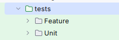
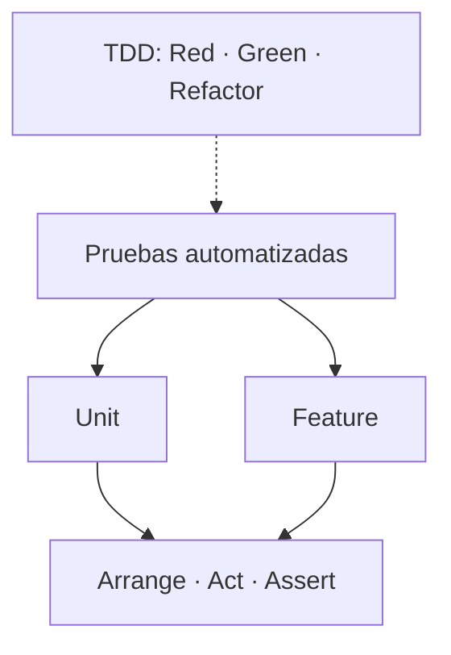

## 1.1. ¿Qué son las pruebas de software?

Las **pruebas de software** son procedimientos que permiten verificar que nuestro código se comporta de la manera esperada y detectar posibles errores en su funcionamiento.

Uno de los aspectos fundamentales del desarrollo de software es la **automatización de las pruebas**, de manera que podamos ejecutarlas tantas veces como sea necesario sin tener que comprobar manualmente cada funcionalidad.

### ¿Por qué son importantes?

Durante el desarrollo de una aplicación es frecuente que funcionalidades que inicialmente funcionaban correctamente dejen de hacerlo después de modificar el código o incorporar nuevas funcionalidades.

Este tipo de situaciones se conoce como **regresiones**: cambios en el software que provocan que una funcionalidad que antes funcionaba correctamente deje de hacerlo.

Las pruebas automatizadas permiten detectar estas regresiones de forma rápida, evitando que los errores pasen inadvertidos.

::: tip Pruebas de regresión
Una **prueba de regresión** permite comprobar que una funcionalidad que anteriormente funcionaba correctamente sigue haciéndolo después de introducir cambios en el código.
:::

Por este motivo, **siempre que detectemos y corrijamos un error, es recomendable incorporar una prueba automatizada que reproduzca el fallo y compruebe que ha quedado solucionado**.

De esta forma, si en el futuro volvemos a introducir accidentalmente el mismo error, la prueba fallará y nos permitirá detectarlo.

### ¿Las pruebas garantizan que nuestro código no tiene errores?

**No.** Que una prueba se ejecute correctamente no significa que el método o la funcionalidad estén libres de errores.

Una prueba únicamente verifica que el código se comporta correctamente en las condiciones y casos que hemos comprobado.

Por ejemplo, supongamos que tenemos una función PHP que divide dos números:

```php
function dividir($a, $b) {
    return $a / $b;
}
```

Si comprobamos que `dividir(10, 2)` devuelve `5`, sabemos que la función funciona correctamente para ese caso.

Sin embargo, ¿qué ocurre si intentamos dividir entre cero?

```php
dividir(10, 0);
```

En este caso, PHP lanzará una excepción `DivisionByZeroError`.

Nuestra primera prueba no había contemplado esta situación.

::: warning Importante
**Superar una prueba no garantiza que el código sea correcto en todas las situaciones.**

Cuantos más casos relevantes comprobemos, mayor confianza tendremos en el funcionamiento de nuestro código.

No se trata simplemente de tener muchas pruebas, sino de comprobar adecuadamente los diferentes comportamientos y situaciones que pueden producirse.
:::

### ¿Qué debemos hacer cuando encontramos un error?

Cuando detectamos un fallo en nuestro código, es recomendable seguir este procedimiento:

1. **Reproducir el error:** identificar las condiciones que provocan el fallo.
2. **Crear una prueba automatizada:** comprobar que la prueba falla debido al error detectado.
3. **Corregir el código:** modificar la implementación hasta conseguir que la prueba se supere.
4. **Conservar la prueba:** mantenerla para detectar si el mismo error vuelve a aparecer en el futuro.

De esta manera, cada error corregido puede convertirse en una nueva comprobación automática que mejora la fiabilidad de nuestra aplicación.

### Cobertura de código (Code Coverage)

Un concepto relacionado con las pruebas automatizadas es la **cobertura de código**, que indica qué parte del código de nuestra aplicación se ha ejecutado durante las pruebas.

Por ejemplo, una cobertura del 80 % de líneas significa que las pruebas han ejecutado el 80 % de las líneas consideradas para esta medición.

En PHP, herramientas como **PHPUnit**, junto con **Xdebug** o **PCOV**, permiten generar informes de cobertura que pueden integrarse en plataformas como GitHub o GitLab.

::: info Cobertura y calidad
Una cobertura elevada es un indicador útil, pero **no garantiza que nuestro código esté libre de errores**.

Podemos ejecutar todas las líneas de un método sin comprobar correctamente sus resultados.

Por tanto, la cobertura debe interpretarse como una medida del alcance de nuestras pruebas, no como una garantía de calidad.
:::

### Pruebas y depuración

Aunque están relacionadas, **probar y depurar no son lo mismo**:

- **Probar (Testing):** comprobar si el software se comporta de la manera esperada y detectar posibles fallos.
- **Depurar (Debugging):** investigar las causas de un fallo y corregir el código que lo provoca.

Las pruebas nos ayudan a descubrir que algo no funciona correctamente, mientras que la depuración nos permite averiguar por qué ocurre.

::: tip En resumen
Las pruebas automatizadas nos permiten:

- **Detectar errores** en el funcionamiento del software.
- **Prevenir regresiones** cuando modificamos el código.
- **Comprobar automáticamente** funcionalidades sin repetir verificaciones manuales.
- **Facilitar el mantenimiento** y la evolución de nuestras aplicaciones.
- **Desarrollar con mayor confianza**, al disponer de comprobaciones que verifican el comportamiento esperado.

**Las pruebas no garantizan la ausencia de errores, pero constituyen una herramienta fundamental para desarrollar software fiable y mantenible.**
:::


# Tipos de pruebas: Unit y Feature

::: objetivos Objetivos de aprendizaje | fa-list-check

- Distinguir entre pruebas unitarias y pruebas de funcionalidad.
- Comprender qué partes de una aplicación verifica cada tipo de prueba.
- Identificar cuándo conviene utilizar cada una.
- Relacionar Unit y Feature con AAA y TDD.
- Conocer cómo organiza Laravel las pruebas mediante `Unit` y `Feature`.

:::
## Unit Test Vs Feature test
Pruebas unitarias Vs pruebas de funcionalidad.

Es una diferencia importante, y cuando trabajemos con un framework, como ocurre con laravel, diferenciaremos este tipo de pruebas y las ubicaremos en directorios diferentes




## ¿Qué queremos comprobar cuando hacemos una prueba?

No todas las pruebas tienen el mismo propósito.

Podemos querer comprobar que una función calcula correctamente un resultado, o verificar que varios componentes colaboran para realizar una operación completa.

Aquí tenemos las dos tipos de pruebas de test:
* **pruebas unitarias**
* **pruebas de funcionalidad**.

## Pruebas unitarias (Unit Tests)

::: definicion Prueba unitaria | fa-vial

Una **prueba unitaria** comprueba el comportamiento de una pequeña unidad de código, normalmente una función o un método, de forma aislada respecto a sus dependencias externas.

Su objetivo es verificar que esa unidad produce el resultado esperado para unas entradas determinadas.

:::

Por ejemplo, tenemos una función que calcula el precio después de aplicar un descuento:

<PhpRunner>

```php
<?php

function aplicarDescuento(float $precio, float $porcentaje): float
{
    return $precio - ($precio * $porcentaje / 100);
}

echo aplicarDescuento(100, 20);
```

</PhpRunner>

Podemos probarla utilizando PHPUnit:

```php
<?php

use PHPUnit\Framework\TestCase;

class DescuentoTest extends TestCase
{
    public function test_aplicar_descuento(): void
    {
        // Arrange: preparar los datos
        $precio = 100;
        $descuento = 20;

        // Act: ejecutar la función
        $resultado = aplicarDescuento($precio, $descuento);

        // Assert: comprobar el resultado
        $this->assertEquals(80, $resultado);
    }
}
```

Este ejemplo supone que la función `aplicarDescuento()` está cargada en el entorno de pruebas.

La prueba:

- No necesita una base de datos.
- No necesita un servidor web.
- No depende de Laravel.
- Comprueba únicamente el comportamiento de la función.

Su propio nombre alude a su intención

## Pruebas de funcionalidad (Feature Tests)

::: definicion Prueba de funcionalidad | fa-gears

Una **prueba de funcionalidad** verifica que una característica o comportamiento de la aplicación funciona correctamente.

Normalmente, involucra varios componentes que colaboran entre sí, como controladores, servicios, modelos o bases de datos.

:::

Por ejemplo, imaginemos una aplicación que permite registrar usuarios.

Una prueba de funcionalidad podría verificar que:

1. El usuario envía un formulario de registro.
2. La aplicación valida los datos.
3. Se crea el usuario en la base de datos.
4. La aplicación devuelve la respuesta esperada.

En este caso no comprobamos solamente una función, sino **el funcionamiento conjunto de varios componentes**.

::: tip Importante

Una prueba de funcionalidad no tiene por qué comprobar toda la aplicación.

Puede verificar una única característica, como registrar un usuario, consultar un producto o crear un pedido.

:::

## Comparación entre Unit y Feature

| Característica | Unit | Feature |
|---|---|---|
| Objetivo | Comprobar una unidad de código | Comprobar una funcionalidad |
| Alcance | Pequeño | Generalmente mayor |
| Dependencias | Aisladas o simuladas | Pueden intervenir componentes reales |
| Base de datos | Normalmente no | Puede utilizarse |
| Velocidad | Generalmente muy rápida | Puede ser más lenta |
| Ejemplo | Calcular un descuento | Registrar un usuario |

## ¿Qué relación tienen con AAA y TDD?

Es importante no confundir estos conceptos:

- **Unit y Feature** indican qué estamos probando y con qué alcance.
- **AAA** indica cómo organizamos el código de una prueba.
- **TDD** indica cómo desarrollamos el software utilizando primero las pruebas.

Por tanto, podemos escribir pruebas unitarias y pruebas de funcionalidad siguiendo AAA, y desarrollar ambas mediante TDD.



## Unit y Feature en Laravel

Laravel organiza habitualmente las pruebas en dos directorios:

```text
tests/
├── Feature/
│   └── ExampleTest.php
├── Unit/
│   └── ExampleTest.php
└── TestCase.php
```

Podemos generar una prueba utilizando Artisan:

```bash
php artisan make:test UsuarioTest
```

Por defecto, Laravel crea:

```text
tests/Feature/UsuarioTest.php
```

Si utilizamos la opción `--unit`:

```bash
php artisan make:test DescuentoTest --unit
```

Laravel crea:

```text
tests/Unit/DescuentoTest.php
```

::: warning Una distinción importante

La opción `--unit` no convierte automáticamente una prueba en unitaria.

Simplemente indica a Laravel que genere el archivo en el directorio `tests/Unit` utilizando la plantilla correspondiente.

Una prueba será realmente unitaria por su diseño, su alcance y el aislamiento de sus dependencias, no por el directorio donde se encuentre.

:::

### Una diferencia importante en Laravel

Las pruebas unitarias generadas por Laravel con PHPUnit normalmente extienden directamente la clase `PHPUnit\Framework\TestCase`.

```php
<?php

namespace Tests\Unit;

use PHPUnit\Framework\TestCase;

class CalculadoraTest extends TestCase
{
    public function test_suma(): void
    {
        $this->assertEquals(5, 2 + 3);
    }
}
```

En cambio, las pruebas Feature generadas con PHPUnit suelen extender la clase base de pruebas de la aplicación:

```php
<?php

namespace Tests\Feature;

use Tests\TestCase;

class PaginaInicioTest extends TestCase
{
    public function test_pagina_inicio(): void
    {
        $response = $this->get('/');

        $response->assertStatus(200);
    }
}
```

La clase `Tests\TestCase` permite iniciar el entorno de pruebas de Laravel y utilizar sus herramientas, como las peticiones HTTP simuladas.

Por eso, una prueba Feature puede verificar el comportamiento de una ruta sin necesidad de arrancar manualmente un servidor web.

::: tip Para recordar

**Unit:** ¿funciona correctamente esta función o método?

**Feature:** ¿funciona correctamente esta característica de la aplicación?

**AAA:** ¿cómo organizo la prueba?

**TDD:** ¿en qué orden escribo las pruebas y el código?

:::

## ¿Cuándo aprender cada tipo de prueba?

Al comenzar a programar funciones, las pruebas unitarias son especialmente útiles porque permiten comprobar resultados de manera sencilla.

Por ejemplo:

- Calcular descuentos.
- Validar una edad.
- Convertir temperaturas.
- Calcular una nota media.
- Comprobar reglas de negocio.

Al avanzar hacia la programación orientada a objetos, podremos probar métodos y clases, aislando sus dependencias cuando sea necesario.

Más adelante, al desarrollar aplicaciones web con Laravel, incorporaremos pruebas Feature para comprobar rutas, controladores, validaciones y operaciones con bases de datos.

::: objetivos Actividad de reflexión | fa-list-check

Clasifica las siguientes pruebas como **Unit** o **Feature**, según el alcance descrito:

1. Comprobar que una función devuelve el IVA correcto.
2. Verificar que un usuario puede iniciar sesión en una aplicación.
3. Comprobar que un método calcula correctamente el salario.
4. Verificar que una petición HTTP crea un producto en la base de datos.
5. Comprobar que una función determina si un número es primo.

**Pregunta:** ¿Podríamos aplicar la arquitectura AAA a todas estas pruebas?

:::
